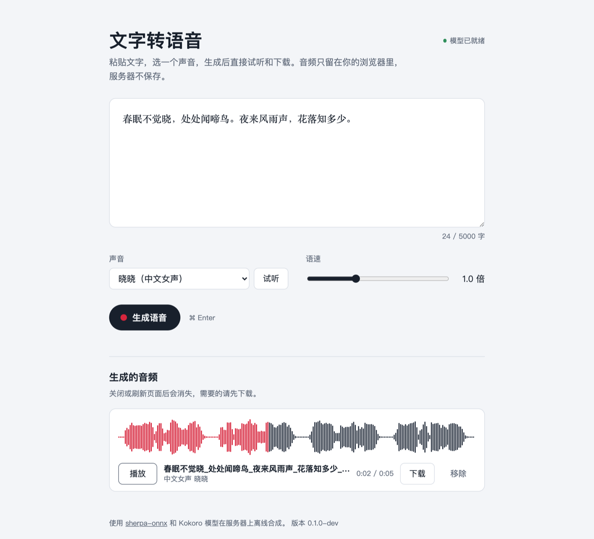

# sherpa-tts-web

在自己的服务器上运行的文字转语音网页：粘贴文字，选一个声音，生成后直接在浏览器里试听和下载 WAV。离线合成，只用 CPU，不调用任何云端接口。

*A self-hosted text-to-speech web page. Offline, CPU-only synthesis with [sherpa-onnx](https://github.com/k2-fsa/sherpa-onnx) and the Kokoro multi-lingual model (Chinese and English). Audio is never written to the server's disk.*



- 36 个中英文声音：中文男声和女声，美式、英式英语男声和女声
- 语速 0.5 到 2 倍，生成前可以先试听声音
- 显示排队和生成进度，可以随时取消
- 生成的音频只放在服务器内存里，浏览器取走后立即删除，没取走的 10 分钟后清掉。服务器硬盘上只有程序和模型
- 首次启动时自动下载模型（约 395 MB），支持断点续传，每个文件都校验 SHA-256
- 可以设置访问密码；日志里不记录用户输入的文字
- 一个可执行文件加两个动态库，或者一个 Docker 镜像

## 快速开始

### Docker Compose

```sh
git clone https://github.com/swlfigo/sherpa-tts-web.git && cd sherpa-tts-web
TTS_PASSWORD=换成你的密码 docker compose up -d
docker compose logs -f     # 查看模型下载进度
```

打开 `http://服务器地址:8080`，用户名随意，密码是上面设置的那个。模型下载好之前，页面会显示下载进度。

### 二进制

在 Releases 页下载对应架构（`linux-amd64` 或 `linux-arm64`）的压缩包。解压后的 `lib/` 目录要和程序放在一起：

```sh
tar -xzf sherpa-tts-web-*-linux-amd64.tar.gz && cd sherpa-tts-web-*-linux-amd64
TTS_PASSWORD=换成你的密码 ./sherpa-tts-web -addr :8080 -data-dir ./data
```

长期运行可以用 [deploy/sherpa-tts-web.service](deploy/sherpa-tts-web.service)（systemd），文件开头写了安装步骤。

二进制在 AlmaLinux 8 上编译，只需要 glibc 2.17。已在 CentOS 7、AlmaLinux 8、Ubuntu 20.04 / 22.04、Debian 12 上测试过（x86_64 和 ARM64）。Alpine 等 musl 系统请用 Docker。

### 自己编译

需要 Go 1.26 或更新版本，以及 C 编译器（sherpa-onnx 通过 cgo 调用）：

```sh
CGO_ENABLED=1 go build -o sherpa-tts-web .
```

在 Linux 上这样编译出来的程序，会到 Go 模块缓存里找 sherpa-onnx 的动态库，只适合在本机运行。要发布给别的机器，请用 Docker 构建，会把库一起打包：

```sh
docker buildx build --target dist --output type=local,dest=dist .
```

macOS 也能直接 `go run .`，方便开发调试。

## 配置

参数可以用命令行，也可以用环境变量（Docker 里更方便）：

| 环境变量 | 命令行 | 默认值 | 说明 |
|---|---|---|---|
| `TTS_PASSWORD` | 无 | 空 | 访问密码，用浏览器自带的登录框输入，用户名随意。只能用环境变量设置，避免出现在进程列表里。不设置就不需要密码，启动时会打印警告 |
| `TTS_ADDR` | `-addr` | `:8080` | 监听地址 |
| `TTS_DATA_DIR` | `-data-dir` | `data` | 模型下载到这个目录 |
| `TTS_MODEL_DIR` | `-model-dir` | 空 | 使用已经放好的模型目录，不再下载 |
| `TTS_MODEL_URL` | `-model-url` | 空 | 模型文件的镜像地址，优先从这里下载 |
| `TTS_MAX_CHARS` | `-max-chars` | `5000` | 一次最多多少字 |
| `TTS_MAX_QUEUE` | `-max-queue` | `20` | 最多排队几个任务，超出的会提示稍后再试 |
| `TTS_THREADS` | `-threads` | CPU 核数，最多 8 | 推理线程数 |

## 模型下载

默认先从 hf-mirror.com 下载，失败再换 huggingface.co，固定在 [csukuangfj/kokoro-multi-lang-v1_0](https://huggingface.co/csukuangfj/kokoro-multi-lang-v1_0) 的一个版本，文件清单和校验值在 [internal/model/manifest.json](internal/model/manifest.json)。

如果服务器连不上这两个地址：

- **自己放一份镜像**：把模型目录原样上传到对象存储或任意 HTTP 服务器，设置 `TTS_MODEL_URL=https://你的地址/kokoro-multi-lang-v1_0/`。文件仍然按清单校验。
- **直接拷贝模型**：在能联网的机器上下载 [kokoro-multi-lang-v1_0.tar.bz2](https://github.com/k2-fsa/sherpa-onnx/releases/download/tts-models/kokoro-multi-lang-v1_0.tar.bz2)，解压后拷到服务器，设置 `TTS_MODEL_DIR=解压出的目录`。

## 服务器配置建议

| 使用情况 | CPU | 内存 | 磁盘 |
|---|---|---|---|
| 几个人偶尔用（最低） | 2 核 | 2 GB | 10 GB |
| 几个人经常用（推荐） | 4 核 | 4 GB | 20 GB |
| 多人同时用 | 8 核 | 8 GB | 20 GB |

- 不需要 GPU。加载模型后内存占用约 850 MB。
- 任务一个接一个处理，每个任务用满所有推理线程；试听会插队优先处理。
- 速度参考：Apple M4（4 线程）上，生成 17 秒的音频约 4 秒。普通云服务器会慢一些，建议部署后实际测一下。
- 带宽：1 分钟 WAV 约 2.9 MB（24 kHz、16 位、单声道）。

## HTTPS 和反向代理

浏览器登录框的密码是明文传输的，对外开放时请放在 HTTPS 后面。用 [Caddy](https://caddyserver.com) 最简单，它会自动申请证书，示例见 [deploy/Caddyfile](deploy/Caddyfile)。

用 Nginx 时，试听请求最多可能等 2 分钟（排在正在运行的任务后面），请把 `proxy_read_timeout` 调到 150s 以上。

## 数据和隐私

- 用户输入的文字只用来合成，不写进日志，也不写进硬盘。
- 生成的音频只放在内存里：浏览器取走后立即删除；没有取走的 10 分钟后删除；内存里的结果总共超过 256 MB 时，先删最早的。
- 页面在浏览器里保存生成的音频，刷新或关闭页面就没了。还有没下载的音频时关闭页面，浏览器会先提示。
- 关闭页面会顺带取消还在排队或生成的任务；2 分钟没有页面来查询的任务也会自动取消。

## API

页面用的就是这些接口，脚本也可以直接调用（设置了密码时要加 HTTP Basic 认证）：

| 方法和路径 | 说明 |
|---|---|
| `GET /api/status` | 模型状态（下载进度等）和队列长度 |
| `GET /api/voices` | 声音列表 |
| `POST /api/jobs` | 提交任务：`{"text": "...", "voice": "zf_xiaoxiao", "speed": 1.0}`，返回 `{"id": "..."}` |
| `GET /api/jobs/{id}` | 任务状态：`queued`、`running`、`done`、`failed`、`canceled`，以及进度 |
| `GET /api/jobs/{id}/audio` | 取回 WAV，只能取一次 |
| `POST /api/jobs/{id}/cancel` | 取消任务 |
| `POST /api/preview` | 试听：`{"voice": "bf_emma", "speed": 1.0}`，直接返回 WAV |
| `GET /healthz` | 健康检查，不需要密码 |

```sh
id=$(curl -s -u x:$TTS_PASSWORD -H 'Content-Type: application/json' \
  -d '{"text":"你好，世界","voice":"zf_xiaoxiao"}' http://localhost:8080/api/jobs | jq -r .id)
# 等到 state 变成 done
curl -s -u x:$TTS_PASSWORD http://localhost:8080/api/jobs/$id
curl -s -u x:$TTS_PASSWORD -o hello.wav http://localhost:8080/api/jobs/$id/audio
```

## 开发

```sh
go test ./...                     # 用假的语音引擎测试，不需要模型
CGO_ENABLED=0 go test ./...       # 不装 C 编译器也能跑
go run . -model-dir /path/to/kokoro-multi-lang-v1_0   # 用真模型运行
```

代码结构：

| 目录 | 内容 |
|---|---|
| `main.go` | 读取配置，启动服务 |
| `internal/tts` | 语音引擎（sherpa-onnx，需要 cgo）、声音列表、文本整理、WAV 编码 |
| `internal/model` | 模型文件清单和下载 |
| `internal/server` | HTTP 接口、任务队列、模型加载 |
| `web` | 页面（原生 HTML/CSS/JS，编译进程序） |
| `tools/genmanifest` | 换模型版本时用来生成 `manifest.json` |

## 许可

本项目源码使用 [Apache License 2.0](LICENSE)。

二进制和镜像里包含 sherpa-onnx（Apache-2.0）、ONNX Runtime（MIT），以及 sherpa-onnx 编译进去的 eSpeak NG（GPL-3.0），所以二进制和镜像整体按 GPL-3.0 发布。模型不随本项目分发，运行时从 Hugging Face 下载。详见 [THIRD_PARTY_NOTICES.md](THIRD_PARTY_NOTICES.md)。
